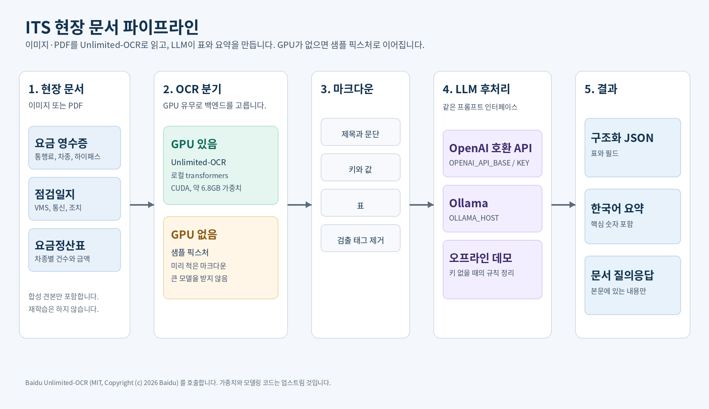
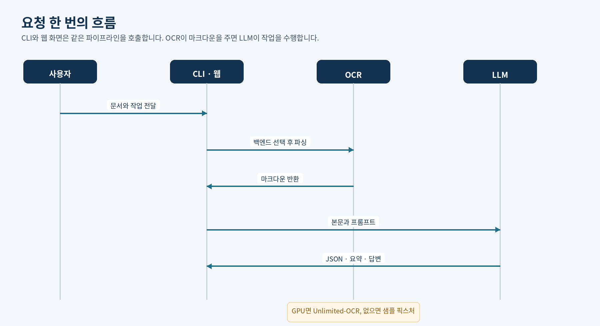

# ITS 현장 문서용 Unlimited-OCR + LLM

[Baidu Unlimited-OCR](https://github.com/baidu/Unlimited-OCR) (Hugging Face [`baidu/Unlimited-OCR`](https://huggingface.co/baidu/Unlimited-OCR), MIT)로 요금징수·점검·인프라 현장 문서를 읽고, LLM으로 표 JSON, 한국어 요약, 문서 질의응답을 만드는 초보자용 파이프라인입니다.

모델을 다시 학습하지 않습니다. GPU가 있으면 업스트림 가중치를 호출하고, 없으면 샘플용으로 적어 둔 OCR 마크다운으로 같은 이후 단계를 실행합니다.

원저작권은 Baidu에 있습니다. Copyright (c) 2026 Baidu. 논문: [Unlimited OCR Works](https://arxiv.org/abs/2606.23050). 이 저장소의 래퍼 코드도 MIT이며, 라이선스 전문과 업스트림 고지는 `LICENSE`에 있습니다.

## 초보 3단계

GPU, Hugging Face 토큰, API 키가 없어도 샘플 세 개는 끝까지 실행됩니다.

### 1. 설치

```bash
python3 -m venv .venv
source .venv/bin/activate
pip install -r requirements.txt
cp .env.example .env
```

`.env`는 비워 두어도 됩니다. `requirements.txt`에는 torch가 없습니다.

### 2. 샘플 실행

```bash
python -m ocr_llm_its run --input samples/toll_receipt.png --task summarize
python -m ocr_llm_its run --input samples/settlement_table.pdf --task extract
python -m ocr_llm_its run --input samples/inspection_log.png --task qa --question "통신 점검 결과는?"
```

화면으로 보려면:

```bash
python -m ocr_llm_its ui
```

브라우저에서 `http://127.0.0.1:7860` 을 엽니다.

### 3. 결과 확인

표준 출력은 JSON입니다. `result`가 요약 문장, 구조화 객체, 또는 답변입니다. `ocr.backend`가 `fixture`이면 큰 모델을 받지 않고 `samples/fixtures/`의 마크다운을 읽은 것입니다. `llm.backend`가 `offline`이면 API 대신 규칙 기반 데모 정리기가 동작한 것입니다. 안내 문장은 표준 오류로도 출력됩니다.

영수증 요약 예:

```bash
python -m ocr_llm_its run \
  --input samples/toll_receipt.png \
  --task summarize \
  --backend fixture \
  --llm offline
```

키와 API가 없을 때의 영수증 요약은 다음 문장입니다.

> 문서 제목은 통행료 영수증이고 종류는 통행영수증입니다. 주요 항목은 문서번호 TR-20260314-0312, 영업소 서울요금소, 차로 3, 차량번호 12가 3456, 차종 1종 (승용), 진입영업소 판교, 통행료 3,200원, 결제수단 하이패스입니다.

`extract`는 `fields`와 `tables`가 있는 JSON입니다.

## 파이프라인





1. 이미지 또는 PDF를 넣습니다.
2. OCR 백엔드가 마크다운을 만듭니다.
3. LLM이 작업 하나를 수행합니다.
   - `extract`: 표와 필드를 JSON으로
   - `summarize`: 한국어 요약
   - `qa`: 문서에 근거한 답변

다이어그램 파일:

- `docs/images/architecture.png`
- `docs/images/sequence.png`

글자는 Noto Sans CJK KR로 그렸습니다.

## GPU가 필요할 때

로컬 백엔드는 업스트림 `infer`가 입력을 `.cuda()`로 올리는 NVIDIA GPU 경로만 감쌉니다. CPU나 Apple MPS로는 실행하지 않습니다.

공개 모델 카드 기준 가중치는 BF16 약 33억 파라미터이고, 파일 크기는 약 6.8GB입니다. 크롭(gundam, 640px)과 긴 문맥(최대 32,768 토큰)의 활성화 메모리는 가중치 위에 더해집니다. 이 저장소에서 VRAM을 실측하지는 않았습니다. 가중치만으로도 수 GB이므로 16GB 카드는 짧은 이미지에서도 빠듯할 수 있고, 여러 페이지 PDF는 24GB 이상을 보고 잡는 편이 안전합니다.

업스트림 README가 확인한 환경은 Python 3.12, CUDA 12.9, `torch==2.10.0`, `transformers==4.57.1`입니다. 맞추려면 `requirements-gpu.txt`를 사용하세요. 첫 실행에 Hugging Face에서 가중치 전체를 받습니다. 모델은 gated가 아니라서 `HF_TOKEN`은 선택입니다. 받기 제한에 걸리면 토큰을 넣으세요.

로컬 추론은 `trust_remote_code=True`로 업스트림 모델링 코드를 실행합니다. 그 코드는 Baidu 저장소의 것이며, 이 래퍼가 다시 구현한 것이 아닙니다.

```bash
pip install -r requirements-gpu.txt
python -m ocr_llm_its run --input samples/toll_receipt.png --task extract --backend local
```

`--backend local`은 GPU가 없으면 픽스처로 넘어가지 않고 이유를 알리고 멈춥니다. `--backend auto`만 GPU가 없을 때 픽스처로 넘어갑니다.

## 환경 변수

`.env.example`을 복사해 사용합니다.

| 변수 | 역할 |
| --- | --- |
| `HF_TOKEN` | 선택. 가중치 다운로드용 |
| `OPENAI_API_BASE` | OpenAI 호환 주소. `/v1`까지 포함 |
| `OPENAI_API_KEY` | 있으면 `auto`가 이 API를 사용 |
| `OPENAI_MODEL` | 기본 `gpt-4o-mini` |
| `OLLAMA_HOST` | 기본 `http://127.0.0.1:11434` |
| `OLLAMA_MODEL` | 기본 `qwen2.5:7b` |
| `OCR_BACKEND` | `auto`, `fixture`, `local` |
| `LLM_BACKEND` | `auto`, `openai`, `ollama`, `offline` |

Ollama를 쓸 때는 모델을 먼저 받아 둡니다.

```bash
ollama pull qwen2.5:7b
python -m ocr_llm_its run --input samples/toll_receipt.png --task summarize --llm ollama
```

`auto`는 API 키가 있으면 OpenAI 호환 서버, 없고 Ollama가 응답하면 Ollama, 둘 다 없으면 오프라인 데모 순서로 고릅니다. 오프라인 경로는 신경망이 아닙니다. 마크다운의 표와 `키: 값`을 읽어 세 작업을 채우므로, 양식이 비슷한 샘플에서 흐름을 확인하는 용도입니다.

## 샘플 문서

모두 합성 견본입니다. 실제 징수나 점검 기록이 아닙니다.

| 파일 | 내용 | 픽스처 |
| --- | --- | --- |
| `samples/toll_receipt.png` | 통행료 영수증 | `samples/fixtures/toll_receipt.md` |
| `samples/inspection_log.png` | VMS 점검일지 | `samples/fixtures/inspection_log.md` |
| `samples/settlement_table.pdf` | 차종별 요금정산표 | `samples/fixtures/settlement_table.md` |

픽스처 마크다운은 같은 내용을 사람이 적어 둔 자리표시자입니다. 이 환경에서 Unlimited-OCR을 돌려 만든 출력이 아닙니다. GPU 경로를 쓰면 모델 출력으로 바뀌고, `<|det|>` 같은 검출 태그는 업스트림 README의 후처리 방식으로 걷어 낸 뒤 LLM에 넘깁니다.

다른 파일을 픽스처로 쓰려면 `samples/fixtures/<파일명>.md`를 추가하면 됩니다. 확장자를 뺀 이름이 같아야 합니다.

## 테스트

GPU 없이 실행됩니다. LLM 호출은 가짜 응답이거나 오프라인 정리기입니다.

```bash
python -m unittest
```

## 인용

업스트림 논문을 사용했다면 Baidu 쪽을 인용하세요.

```bibtex
@misc{yin2026unlimitedocrworks,
      title={Unlimited OCR Works},
      author={Youyang Yin and Huanhuan Liu and YY and Qunyi Xie and Chaorun Liu and Shiqi Yang and Shaohua Wang and Zhanlong Liu and Hao Zou and Jinyue Chen and Shu Wei and Jingjing Wu and Mingxin Huang and Zhen Wu and Guibin Wang and Tengyu Du and Lei Jia},
      year={2026},
      eprint={2606.23050},
      archivePrefix={arXiv},
      primaryClass={cs.CV},
      url={https://arxiv.org/abs/2606.23050}
}
```
